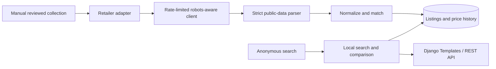

# Architecture and matching decisions

Search never performs retailer requests. SQLite is used locally; the same models target PostgreSQL via `DATABASE_URL`. Categories are normalized independently; brands are a bounded string field for the MVP. Retailer status describes source readiness, not the presence of fictional demo listings. Canonical products and listings have explicit demo/live flags; the ingestion service keeps them in separate matching pools.

`Product.quantity` stores normalized base-unit size per package (`ml`, `g`, or `pc`), with `pack_count` separately. A pack of six 1L cartons does not match a single 6L container. Titles with multiple ambiguous quantities have no inferred size and cannot automatically match a different listing. Known brands and aliases are normalized. Empty brand or size prevents automatic cross-listing matches.

Candidate matching requires equal brand, quantity, base unit, pack count, known variants, and packaging signature. Explicit GTIN disagreement rejects a match. GTIN agreement still cannot override an incompatible size or variant. Compatible names use RapidFuzz `token_sort_ratio`, with a minimum score of 92 and a five-point margin over the runner-up. Ambiguous candidates create a separate canonical record. Existing unchanged unknown identities retain their original canonical record on updates. Variant vocabulary is deliberately conservative but finite: this is an MVP matcher, not a general proof of product identity. Unknown variants, new retailers, and brand catalog additions need review before expanding automatic linking.

Public search uses looser fuzzy relevance because discovery can return related products. An explicitly parsed quantity, brand, or known variant still narrows results. Search retrieval is capped at 1,000 database candidates; large catalogs need indexed full-text/trigram retrieval and database-level pagination. Nothing in this search path creates canonical matches.

Ingestion validates source origin, PKR price and availability, then atomically updates a stable retailer/product-area identifier and appends a `PriceHistory` snapshot. Existing listing updates are row-locked. A conditional unique constraint permits one running `ScrapeRun` per retailer; the manual command acquires it before requests and releases it by recording a terminal status. First-time canonical creation across different retailers can still race; larger deployments need a queue and conflict policy before introducing workers. A hard process kill can leave an active run requiring operator inspection; no stale run is automatically cleared. History remains associated with its retailer listing if a changed title forces canonical reassignment.

Listings are sorted by numeric decimal price. The lowest observed price considers in-stock availability and a fresh check within `PRICE_STALE_HOURS` (default 48). Stale and unavailable listings remain visible with status. A winning comparison additionally requires multiple distinct retailers with one known area: `has_comparison` is false for a single retailer or unverified areas. Ties can have multiple winners when these conditions hold. Mixed areas suppress winner badges and savings; a numerical minimum is still returned with `has_mixed_areas=true`. Verify final checkout costs with the retailer.

The client stays on a configured HTTPS origin, checks robots per run, respects a minimum five-second interval and stricter robots limits, and caps bodies at 2 MB. Only `requests.Timeout` exceptions can receive one extra GET attempt, delayed after the failure. HTTP errors including 403/429/5xx, redirects, challenges, certificate failures, and other connection errors never retry. No bot identity switching occurs. Protego handles wildcard/allow precedence and repeated groups. Adapters validate every selected URL before any request, require one PKR JSON-LD Product/Offer and a matching heading, and exclude descriptions/images. Typed errors, actual HTTP request counts, and per-URL outcomes are persisted in `ScrapeRun`; optional local JSON reports expose the same metadata. Completed observations survive a later failure. Saved batches, existing-listing refresh, stale-only selection, and dry runs support deliberate repeatable collection; no-URL refreshes do no work. See the runbook and dated source review for live verification and remaining source limits.

Cartpk is a source-specific exception to the JSON-LD parsing strategy: its public description contains an invalid JSON escape. The adapter never repairs or evaluates it. It accepts only the reviewed exact Olper's 1L URL, extracts one final-price element from one product block, cross-checks the visible price against numeric PKR metadata, and rejects configurable variants, incompatible product identities, and conflicting stock labels. Recommendation prices remain outside the extraction scope. Normalization and ingestion are unchanged; the actual Cartpk 1L listing matched Jalal Sons' existing canonical record. Different or unverified area notes suppress a winning comparison while preserving side-by-side dated listed prices.

There is no automatic scheduling. A later scheduler should call the same reviewed collection/ingestion boundaries, with overlap prevention, per-source quotas, global backoff, and source validation refreshes. No pandas dependency is needed for the transactional MVP; introduce it when an actual batch-cleaning or analysis workflow justifies it.
