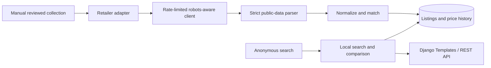

# Architecture and matching decisions

Search never performs retailer requests. SQLite is used locally; the same models target PostgreSQL via `DATABASE_URL`. Categories are normalized independently; brands are a bounded string field for the MVP. Retailer status describes source readiness, not the presence of fictional demo listings. Canonical products and listings have explicit demo/live flags; the ingestion service keeps them in separate matching pools.

`Product.quantity` stores normalized base-unit size per package (`ml`, `g`, or `pc`), with `pack_count` separately. A pack of six 1L cartons does not match a single 6L container. Titles with multiple ambiguous quantities have no inferred size and cannot automatically match a different listing. Known brands and aliases are normalized. Empty brand or size prevents automatic cross-listing matches.

Candidate matching requires equal brand, quantity, base unit, pack count, known variants, and packaging signature. Explicit GTIN disagreement rejects a match. GTIN agreement still cannot override an incompatible size or variant. Compatible names use RapidFuzz `token_sort_ratio`, with a minimum score of 92 and a five-point margin over the runner-up. Ambiguous candidates create a separate canonical record. Existing unchanged unknown identities retain their original canonical record on updates. Variant vocabulary is deliberately conservative but finite: this is an MVP matcher, not a general proof of product identity. Unknown variants, new retailers, and brand catalog additions need review before expanding automatic linking.

Public search uses looser fuzzy relevance because discovery can return related products. An explicitly parsed quantity, brand, or known variant still narrows results. Search retrieval is capped at 1,000 database candidates; large catalogs need indexed full-text/trigram retrieval and database-level pagination. Nothing in this search path creates canonical matches.

Ingestion validates source URL origin, PKR price and availability, then atomically updates a stable retailer/product-area identifier and appends a `PriceHistory` snapshot. Updates to an existing listing are row-locked. The unique listing constraint prevents duplicate identity rows, but first-time concurrent imports and concurrent canonical creation can still race; current collection is sequential and unscheduled. Larger deployments need an ingestion queue and conflict retry/review policy before adding concurrent workers. History stays associated with the retailer listing when a changed title forces canonical reassignment; a future product-level history visualization must account for these identity changes.

Listings are sorted by numeric decimal price. Lowest-price eligibility requires in-stock availability and a fresh check within `PRICE_STALE_HOURS` (default 48). Stale and unavailable listings remain visible with their status. An unknown or out-of-stock price cannot become a winning offer. Ties can have multiple winners. Mixed delivery areas suppress winner badges and savings calculations. A numerical lowest observation can still be returned with `has_mixed_areas=true`, and the UI warns that it is not a direct comparison. Unknown areas cannot prove comparable final checkout totals; always verify with the retailer.

The HTTP client is restricted to each configured HTTPS origin, checks robots per run, respects a minimum five-second interval and stricter crawl delays/rates, caps response bodies at 2 MB, applies timeouts, and rejects redirects, errors, and obvious access challenges without retries. Unknown or unavailable robots fail closed. The built-in robot parser does not fully implement every modern wildcard/allow-precedence extension; a future adapter must validate its allowed path scope explicitly for that source before activation. The Al-Fatah offline parser only accepts one JSON-LD Product with one PKR Offer; it rejects aggregated and multiple variant offers. Synthetic test fixtures demonstrate parser behavior only and do not establish source compatibility or collection permission.

There is no automatic scheduling. A later scheduler should call the same reviewed collection/ingestion boundaries, with overlap prevention, per-source quotas, global backoff, and source validation refreshes. No pandas dependency is needed for the transactional MVP; introduce it when an actual batch-cleaning or analysis workflow justifies it.
