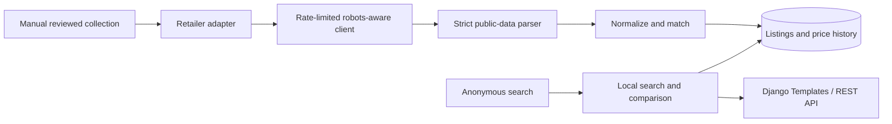

# Architecture and matching decisions

Search never performs retailer requests. SQLite is used locally; the same models target PostgreSQL via `DATABASE_URL`. Categories are normalized independently; brands are a bounded string field for the MVP. Retailer status describes source readiness, not the presence of fictional demo listings. Canonical products and listings have explicit demo/live flags; the ingestion service keeps them in separate matching pools.

`Product.quantity` stores normalized base-unit size per package (`ml`, `g`, or `pc`), with `pack_count` separately. A pack of six 1L cartons does not match a single 6L container. Titles with multiple ambiguous quantities have no inferred size and cannot automatically match a different listing. Known brands and aliases are normalized. Empty brand or size prevents automatic cross-listing matches.

Candidate matching requires equal brand, quantity, base unit, pack count, known variants, and packaging signature. Explicit GTIN disagreement rejects a match. GTIN agreement still cannot override an incompatible size or variant. Compatible names use RapidFuzz `token_sort_ratio`, with a minimum score of 92 and a five-point margin over the runner-up. Ambiguous candidates create a separate canonical record. Existing unchanged unknown identities retain their original canonical record on updates. Variant vocabulary is deliberately conservative but finite: this is an MVP matcher, not a general proof of product identity. Unknown variants, new retailers, and brand catalog additions need review before expanding automatic linking.

Public search uses looser fuzzy relevance because discovery can return related products. An explicitly parsed quantity, brand, or known variant still narrows results. Search retrieval is capped at 1,000 database candidates; large catalogs need indexed full-text/trigram retrieval and database-level pagination. Nothing in this search path creates canonical matches.

Ingestion validates source origin, PKR price and availability, then atomically updates a stable retailer/product-area identifier and appends a `PriceHistory` snapshot. Existing listing updates are row-locked. A conditional unique constraint permits one running `ScrapeRun` per retailer; the manual command acquires it before requests and releases it by recording a terminal status. First-time canonical creation across different retailers can still race; larger deployments need a queue and conflict policy before introducing workers. A hard process kill can leave an active run requiring operator inspection; no stale run is automatically cleared. History remains associated with its retailer listing if a changed title forces canonical reassignment.

Listings are sorted by numeric decimal price. The lowest observed price considers in-stock availability and a fresh check within `PRICE_STALE_HOURS` (default 48). Stale and unavailable listings remain visible with status. A live winning comparison additionally requires multiple distinct retailers and a shared `delivery_area_key` with valid evidence for every eligible observation. Matching display text alone does not verify an area. `area_evidence_url` must be on the retailer's HTTPS origin; `area_verified_at` must cover the current check and not be in the future. Model/admin validation and an evidence-completeness database constraint guard this state. Ingestion clears evidence on a new check because current adapters have no verified location context. Ties remain supported, and demo comparisons keep fictional area semantics. Unverified or mixed eligible areas suppress winners/spread; the numerical minimum remains available with `has_unverified_areas`/`has_mixed_areas` caveats. All real areas remain unverified. See [delivery research and safeguards](delivery-areas.md). Verify final checkout costs with the retailer.

The client stays on a configured HTTPS origin, checks robots per run, respects a minimum five-second interval and stricter robots limits, and caps bodies at 2 MB. Only `requests.Timeout` exceptions can receive one extra GET attempt, delayed after the failure. HTTP errors including 403/429/5xx, redirects, challenges, certificate failures, and other connection errors never retry. No bot identity switching occurs. Protego handles wildcard/allow precedence and repeated groups. Adapters validate every selected URL before any request, require one PKR JSON-LD Product/Offer and a matching heading, and exclude descriptions/images. Typed errors, actual HTTP request counts, and per-URL outcomes are persisted in `ScrapeRun`; optional local JSON reports expose the same metadata. Completed observations survive a later failure. Saved batches, existing-listing refresh, stale-only selection, and dry runs support deliberate repeatable collection; no-URL refreshes do no work. See the runbook and dated source review for live verification and remaining source limits.

Cartpk is a source-specific exception to the JSON-LD parsing strategy: its public description contains an invalid JSON escape. The adapter never repairs or evaluates it. It accepts only eight reviewed exact paths defined alongside corresponding Jalal Sons URLs and expected titles in `catalog/scraping/reviewed.py`. Both sources check the expected identity at these URLs, requiring identical normalized name tokens in addition to hard identity compatibility. Cartpk extracts one final-price element and heading from one product block, cross-checks visible price against numeric PKR metadata, and rejects configurable variants and conflicting stock labels. Recommendation and regular/reference prices remain outside the final-price extraction. Narrow normalization covers the observed Milk Pak/Milkpak spelling, Nurpur/Haleeb brand names, and missing whitespace in Full Cream1Ltr; other identity guards remain in force. Milkpak receives the dairy classification and milk illustration. Both import orders and repeated imports are tested for the five milk pairs and three pantry pairs. See the [reviewed catalog](milk-catalog.md). Different or unverified area notes suppress a winning comparison while preserving side-by-side dated listed prices.

There is no automatic scheduling. A later scheduler should call the same reviewed collection/ingestion boundaries, with overlap prevention, per-source quotas, global backoff, and source validation refreshes. No pandas dependency is needed for the transactional MVP; introduce it when an actual batch-cleaning or analysis workflow justifies it.

`refresh_prices` is a manual sequential wrapper over the existing `scrape` command for Jalal Sons and Cartpk only, always selecting stale existing URLs. Each child command exposes its own run and successfully exported report references, reset on every invocation; the wrapper never queries a globally latest run to infer ownership. Expected source errors are summarized and the next source is attempted; unexpected exceptions and operator interruptions stop the sequence. The aggregate exit code reflects errors even when another source succeeded. Fresh targets create no runs or history, and neither command enables scheduling or changes collection gates. See the [command guide](refresh-prices.md).

Product detail requests build server-rendered SVG history geometry with `catalog/services/history.py`, using actual `PriceHistory` timestamps/prices and source-compatible listings. One window query selects the latest 120 records per listing plus a truncation sentinel. Separate series share a time-scaled axis and a disclosed price-range axis; single records are dots and missing records remain empty. An expandable accessible table and existing paginated history links expose exact values. JavaScript enhances series visibility and point inspection without fetching or mutating records. Demo charts remain explicitly fictional and separate from collected observations. See [price-history behavior and checks](price-history.md).

The admin collection-health route lives on `RetailerAdmin`, behind standard admin authentication and view/change permissions for all models whose data it exposes. `catalog/services/collection_health.py` uses one snapshot/cutoff per request, filtered live-only aggregates and per-source run subqueries. Partial observations never masquerade as a fully successful run. A separately paginated stale queue and bounded recent-issue list link to existing admin records. The page is read-only and never invokes collection, changes a source flag or clears an old running run. See [dashboard semantics and validation](collection-health.md).

The reviewed registry also supplies category/illustration metadata for the three pantry pairs. Collection creates the category when needed without loading demo products; ingestion accepts the reviewed illustration only when creating a new canonical product. Existing matched products are preserved. Unreviewed pages receive no inferred pantry classification. Hard oil/spice variant words supplement the original identity checks. The strict source parsers and ten-URL cap are unchanged. See the [pantry review and validation](pantry-catalog.md).
