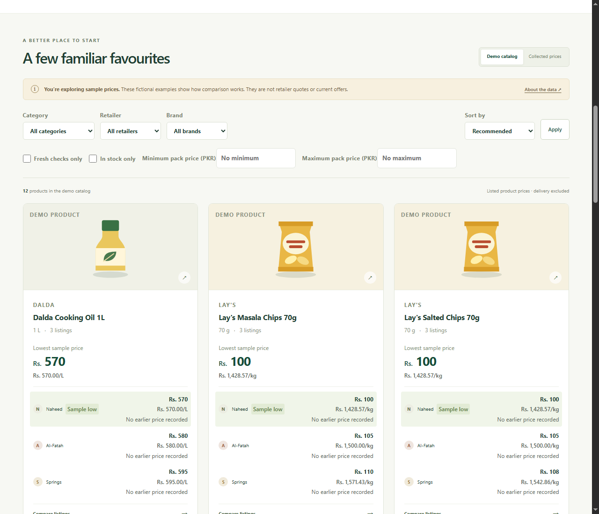
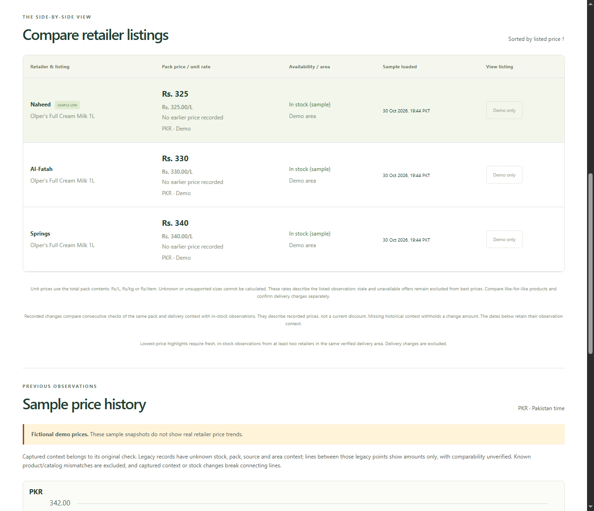
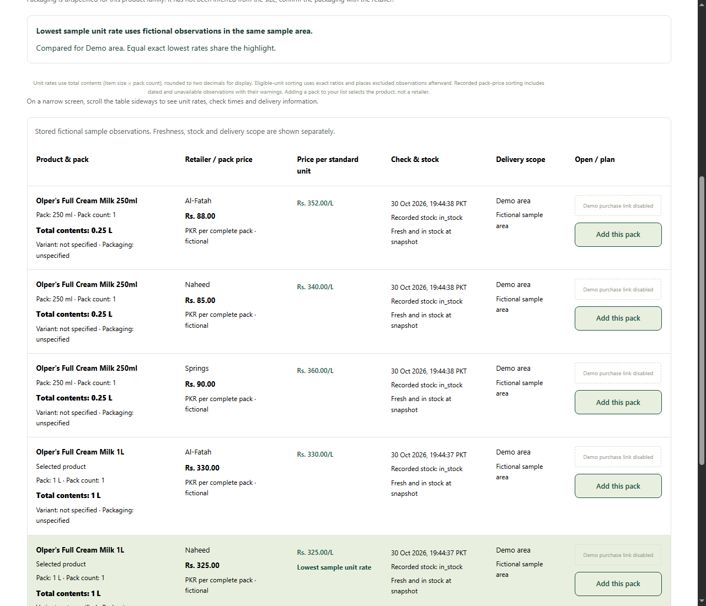
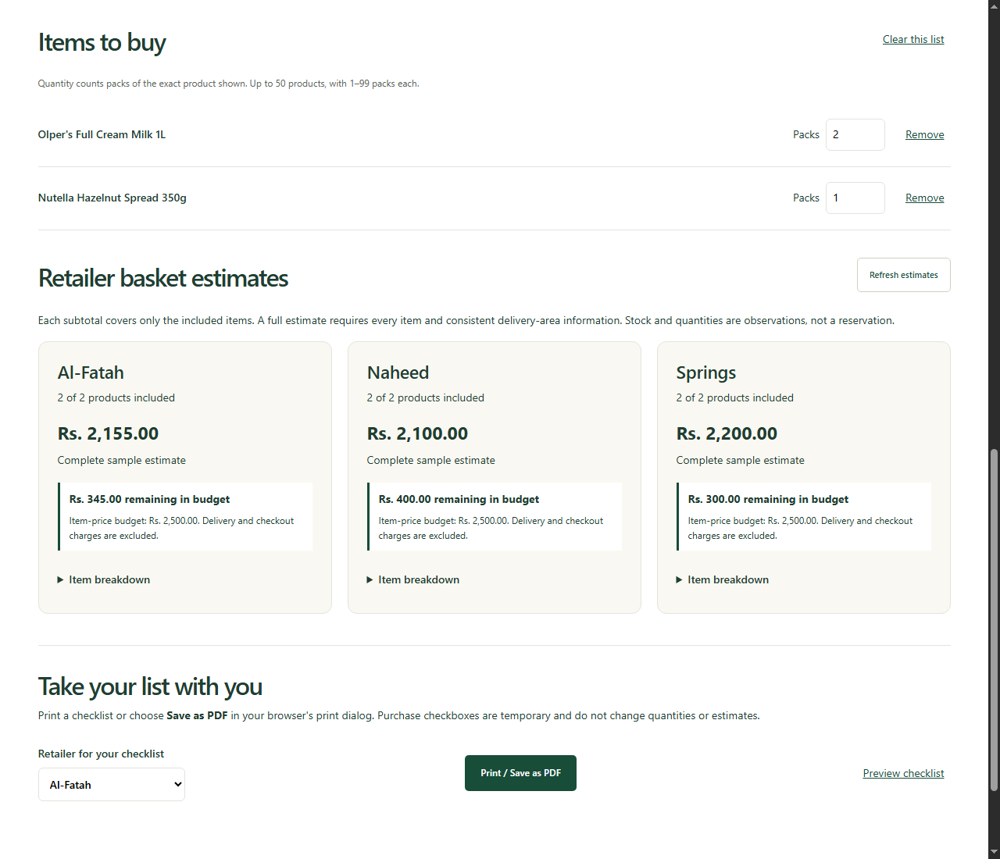
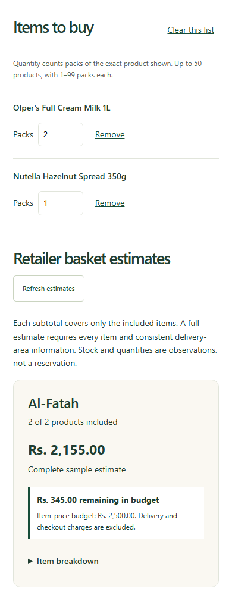
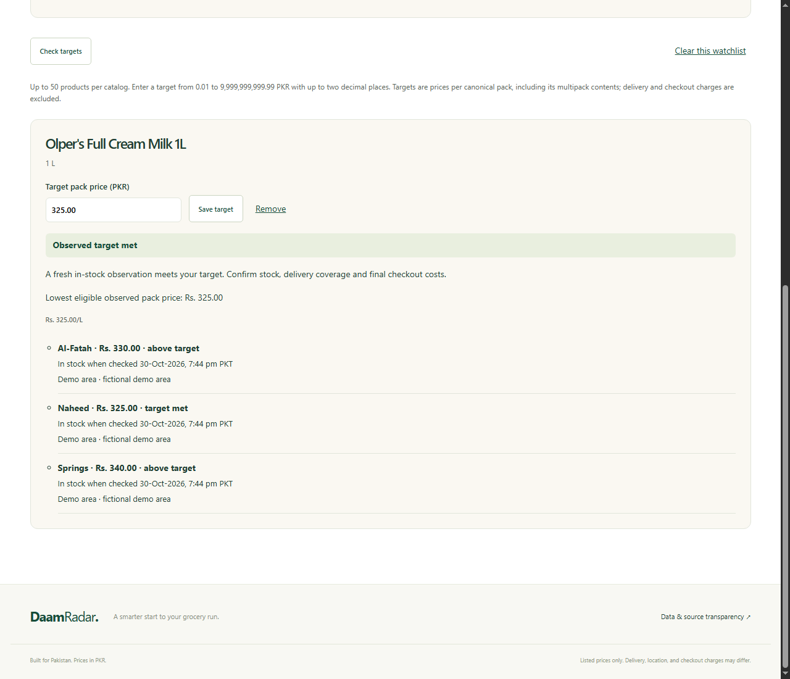

# Demo screenshot gallery

Captured from the running local application in Chrome on **30 October 2026**, using application commit `f82bee6de40a4aab468b8d2449684bc16e77582c` and a separate freshly seeded SQLite database. These are actual browser captures of fictional Demo data, not collected retailer prices. No real catalog, account information or private configuration appears in them. The desktop viewport was 1280 × 1100; the mobile viewport was 390 × 1000.

The demonstration added two packs of Olpers Milk 1L and one Nutella 350g to the Demo list, saved a fictional PKR 2,500 budget and set a fictional PKR 325 target for the milk. These values illustrate the planning controls; they are not current offers. Capture dates are historical evidence, not a statement that an observation remains fresh today.

## Search and catalog

## Dated retailer comparison

## Compatible pack sizes

## Shopping list and budget

## Mobile shopping list

## Target-price watchlist

Twelve browser checks covered catalog labeling, zero collected fixtures, exact-pack additions, comparison observations, quantities and budget, remove/undo, backup controls and watch results, pack comparisons, mobile overflow, the empty collected-source overview, typo search and admin authentication. These checks supplement the offline suite; the screenshots alone do not establish automated accessibility conformance or real retailer availability.
